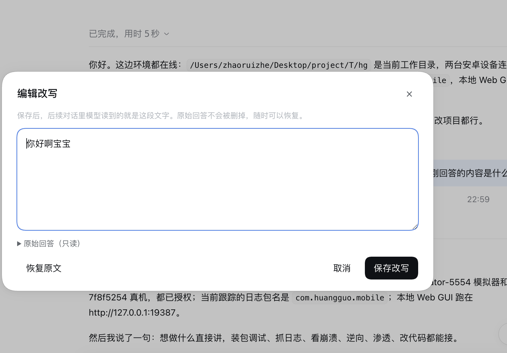

# dsh-message-edit（回答改写）

模型这条回答不好——改它。改写后的版本成为后续对话的上下文，原始回答留在会话日志里。

角色扮演里最常见的动作就是这个：它把台词写歪了，你不想重新生成（重生成十有八九更歪），你想直接把它那句话改成你要的，然后剧情从你的版本继续。dsh 自带的分支/重跑解决不了这件事，因为问题的答案不在"再抽一次"，而在"这一句就该是这么说的"。

```
助手： 她推开门，看见桌上摆着一杯冷掉的咖啡。
       ↓ 点这条回答动作行里的笔
       改写面板：她推开门，看见桌上摆着一把沾血的匕首。
       ↓ 保存
助手： ~~她推开门，看见桌上摆着一杯冷掉的咖啡。~~   ← 日志里的原话（还在）
       [已改写] 她推开门，看见桌上摆着一把沾血的匕首。  ← 这一条起，模型读的是它
你：  她盯着那把匕首看了很久。
       ↓ 下一轮请求里的历史
user: 她推开门，看见桌上摆着一把沾血的匕首。   ← 模型看到的是改写版
```



## 装

```sh
git clone https://github.com/zhaoruizhe81/dsh-message-edit.git
cd dsh-message-edit

# 1) 退出 DeepSeek Harness（profile 的 package.json 有文件锁）
# 2) 用安装自带的 CLI 装（它认得 Desktop 那个保留 profile）
sh "/Applications/DeepSeek Harness.app/Contents/Resources/runtime/cli/bin/dsh" \
  plugin --profile desktop add link:"$PWD"
# 3) 重新打开 App
```

不想动 CLI 也可以，手工三下：在 `~/.dsh/profiles/desktop/package.json` 的 `dependencies` 里加
`"dsh-message-edit": "link:<本目录绝对路径>"`，在 `dsh.profile.bundles` 末尾加一条 `"dsh-message-edit"`，
再把 `~/.dsh/profiles/desktop/node_modules/dsh-message-edit` 软链到本目录。**跑着的 App 会在两秒内自己
reconcile 上这一行**（客户端那半边当场生效）。

**改过 `lib/` 里的宿主代码之后必须重启一次 App。** 宿主半边没有热重载：Node 的模块缓存按 URL 记，loader 重新挂同一行拿到的还是旧模块。客户端半边（`lib/client.js`）不受这个限制——它按 revision 重新取数，保存即生效。

卸载：`dsh plugin --profile desktop remove dsh-message-edit`，或者在「设置 → 插件」里停用这个 bundle。
停用之后模型立刻回到原始历史——改写记录是插件自己的数据，从没写进会话日志。

## 用

**改写**：每条定稿的助手回答，动作行里（复制、分支旁边）多一颗笔。点开是一个面板：正文可改、原始回答可折叠对照、`⌘/Ctrl+Enter` 保存、`Esc` 关掉。

**看改写**：这一轮里被改写过的话，会在动作行上方铺一张改写卡——写的就是改写后的文字，因为你屏幕上也该看到你写的版本。卡上「展开/收起」管长文，「编辑」直接回到面板。不想在对话流里看到它，把 `transcriptCard` 关掉。

**恢复原文**：面板里的「恢复原文」删掉这条改写，一切回到日志里那句。改写卡上再也没有它。

**空着保存**等于恢复原文——手滑删光再保存不会把回答改成空的。

## 它到底做了什么

三条事实决定了它的形状：

**一、改写记录不住在会话日志里。** 记录在 `$DSH_HOME/message-edit/edits.json`：会话 id + 消息 id → 一段文字。会话日志是原始事实，一个字节没动。

**二、改写发生在模型请求出站前。** 宿主的 `llm/stream` 是一条 waterfall，监听器拿到组装好的请求（`GenerateOptions`）。命中改写的会话，插件把那条消息的正文换成改写版，其余字节原样（消息 id、角色、非文本块都不动），然后带着改写后的请求重新派发一次。没有改写的会话走在原路上，这条 listener 连 clone 都不做。

实现上只有一处需要留神：waterfall 的 `next()` 不接受参数，请求对象又是深冻结的，所以"换掉请求内容"只能是**自己再派发一次**。监听器因此用 `prepend` 排在链首（这样链条只完整跑一遍，跑在改写后的请求上，没有二次计费/二次重试/二次检查点），并用一个 WeakSet 保证每个请求只改写一次，不会自激。

**服务要用 `ctx.get('llm')` 读，不要写 `ctx.llm`。** 这是踩过的坑：cordis 里 `ctx.属性` 这种访问**只对声明在 `inject` 里的服务成立**，没声明时它安静地给 `undefined`（不抛错、不打日志）。插件第一版就是这么写的，于是监听器每次都走到"拿不到 llm 运行时"那一行、原样放行——假 ctx 的测试全绿，真机上一条改写都没生效。现在 `llm` 写进了 `inject`，读取也走不受 inject 限制的 `ctx.get('llm')`，两头都堵上。回归测试在 [test/host.test.mjs](test/host.test.mjs)，它跑的是**真的 cordis**（从 dsh checkout 的 `vendor/cordis/lib` 借），不是手搓的假对象。

**三、改写一条消息＝放弃这条消息的复述加成。** 助手消息带 `source.replayState`（适配器复述原始响应用的私货）。留着它，适配器会按 replayState 重建原文字、绕过改写，所以改写版会把 `replayState` 丢掉。这是改写的定义，不是损失。

## 为什么不动会话日志

不是偷懒，是两条路都封着：

**surface 的替换不收助手消息。** dsh 的模型可见层用"位置替换"（`SurfaceOp: {op:'replace'}`）表达历史改写，压缩摘要就是这么做的。但替换事件必须用 `sourceEventSeqs` 把所有被遮蔽的节点列全，而 `assistant/message` **不许带** `sourceEventSeqs`（它由 provider 流嵌入而成）——于是助手消息永远满足不了替换的引用校验。能替换的只剩 `system/user/tool/developer`，那意味着把说话人换成别人：角色扮演里等于让模型以为用户念了它的台词，比不改更糟。

**外部插件不许发明事件类型。** 持久化读路径只认 `KNOWN_SESSION_EVENT_TYPES`（仓库构建期生成的清单），除非事件信封带 `ignorable: true`，而 `Session.append()` 不提供那个标记。外部插件要是写一个新类型下去，这个会话下次打开就会被拒——用一个能写坏会话日志的机制换一条改写，不划算。

所以改写落在请求边界上：**日志照旧诚实，模型看到的是你审过的版本。** 代价说清楚：

- 你屏幕上的转写区仍然是原话（那是日志的append侧），改写版在改写卡和面板里；
- 改写过的那条消息所在的请求前缀会变，服务端的 KV cache 在改写后的第一轮会重算一次（之后照常命中）；
- 插件没装/被停用/记录文件丢了，一切立刻回到原始历史，不需要修数据；
- 别的标签页、别的客户端拿不到实时通知（重连或刷新时会读到最新记录）。

## 配置

在 profile 的 `cordis.patch.yml` 里用同一个 id 覆盖（后面的层覆盖前面的层）：

```yaml
- id: message-edit
  name: dsh-message-edit
  config:
    enabled: true           # 总开关（false＝路由与监听器都不装）
    rewriteInContext: true  # false＝只记录改写，请求一字不改（纯标注）
    transcriptCard: true    # false＝不在对话流里插改写卡
    maxChars: 20000         # 单条改写的长度上限
    dataDir: ~/.dsh/message-edit   # 记录文件所在目录（`~` 会展开）
```

## 接口

宿主四个路由，都在 `/api/dsh-message-edit` 下，同源 + 宿主签名 cookie，客户端那半边就靠它们读写：

```
GET  /status                宿主状态（诊断用）
GET  /list?sessionId=…      这个会话的改写
POST /put                   {sessionId, messageId, text}  空文字＝删除
POST /delete                {sessionId, messageId}
```

失败码：`invalid-session` / `invalid-target` / `invalid-text` / `invalid-body` / `body-too-large`
/ `target-not-found`（会话活着但没这条消息）/ `text-too-large` / `method-not-allowed`。

## 自检

```sh
npm test                      # 74 项单测：记录库、请求改写、路由、真 cordis 宿主接线、真 React 渲染
node dev/probe.mjs            # 打正在跑的宿主：模块图里有这一行吗、bundle 是不是本地这份、
                              # /api 通不通、写一条读回来再删掉

# 端到端（唯一能证明"改写真的进了模型上下文"的那一步）：
# 把插件挂进一个真 AgentLoop 组合，跑两个回合，看第二个回合请求里的正文。
sh dev/run-integration.sh /path/to/deepseek-harness
```

`dev/run-integration.sh` 会在给定 checkout 里临时放两个文件（spec 与插件 lib 副本），跑完自动删——它需要 dsh 的 `@deepseek-ai/*` 包与 vitest，所以必须在源码 checkout 里跑。

`dev/probe.mjs` 会读 `~/.dsh/.credentials.yaml` 里那枚签名密钥，现签一枚一小时后过期的
cookie（和浏览器走同一条取数路径）。密钥只在内存里过一遍，不打印、不落盘。

两套"借宿主机"的测试都靠同一个约定找依赖：`DSH_SOURCE_DIR=/path/to/deepseek-harness`，
或者插件目录旁边正好有一个 `deepseek-harness`；找不到就整段跳过。

- `test/render.test.mjs` 要 `react` / `react-dom` / `jsdom`（真渲染三个 slot 条目）；
- `test/host.test.mjs` 要 `@deepseek-ai/cordis`（真 ctx，不是手搓的假对象）。

## 已知边界

- **只能在定稿的助手回答上改写**。中断留下的半截（没有 messageId）没有动作行，也就没有改写入口。
- **同一 (会话, 消息) 只留一条改写**，后写覆盖前写。没有版本冲突检测——单机单人用够了，多人同时改同一条会后者赢。
- **改写按会话记录**。从某条分支出去的会话（新 session id）不继承父会话的改写，跟 dsh 里别的按消息打标的记录一致。
- **助手半边不热重载**。改 `lib/` 下的宿主代码要重启 App；改 `lib/client.js`（浏览器半边）保存即生效。
- **记录文件是单机的**。换机器、清 `$DSH_HOME`，改写就没了（会话日志还在，历史回到原话）。
- **改写不可见地影响 token 计数**：改写卡不占模型上下文，改写本身按你的文字计费。

## 许可

MIT
